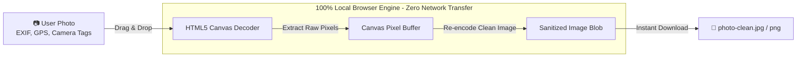

<p align="center"><a href="https://kitsunetechnologies.org/work"></a></p>

# EXIF Remover (Photo Scrub)

> Strip EXIF, GPS coordinates, camera serials, and sensitive metadata from photos entirely inside your browser. Zero uploads, zero tracking, 100% offline-capable.

<p align="center">
  <a href="https://github.com/KitsuneTech1/exif-remover/releases"></a>
  <a href="https://github.com/KitsuneTech1/exif-remover/actions/workflows/ci.yml"></a>
  <a href="LICENSE"></a>
  <a href="https://nodejs.org"></a>
  <a href="package.json"></a>
  <a href="https://kitsunetechnologies.org/play/photo-scrub/"></a>
</p>

<p align="center">
  <a href="https://kitsunetechnologies.org/play/photo-scrub/"><strong>🌐 Launch Live Web App (Zero Install)</strong></a> •
  <a href="https://github.com/KitsuneTech1/exif-remover/releases/latest"><strong>📦 Download Standalone Zip</strong></a>
</p>

---


## Architecture & Data Flow



## Features

- **True Client-Side Scrubbing**: Photos never leave your device. All decoding and re-rendering happen in memory via the browser Canvas API.
- **Batch Processing**: Drop single files or entire batches of JPEG, PNG, and WebP images.
- **Zero Dependencies**: Pure HTML5/JavaScript without external tracking scripts, heavy frameworks, or backend processing.
- **Enterprise Ready**: Includes zero-config preview server, path-traversal hardened file serving, and comprehensive offline test suite.

---

## 🚀 Quick Start for Beginners (No Setup Required)

### Option 1: Use the Online Version (Instant)
Just open **[https://kitsunetechnologies.org/play/photo-scrub/](https://kitsunetechnologies.org/play/photo-scrub/)** in any browser. Drag and drop your images to sanitize them immediately.

### Option 2: Run Locally (One Click)
1. Download the [Latest Release ZIP](https://github.com/KitsuneTech1/exif-remover/releases/latest) and unzip it.
2. Double-click **`start.bat`** (Windows) or execute `./start.sh` (macOS/Linux).
3. The app automatically launches in your default browser at `http://localhost:5173`.

---

## 💻 Developer & Self-Hosting Guide

### Prerequisites
- Node.js 18 or higher (only used for local static serving; no processing is done by Node).

### Clone & Run

```bash
# Clone the repository
git clone https://github.com/KitsuneTech1/exif-remover.git
cd exif-remover

# Start local server (default port 5173)
node server.js
```

### Automated Testing

Run the built-in offline test suite:

```bash
npm test
```

Tests verify:
- Safe filename sanitization and clean extension suffixes.
- Security hardening (symlink confinement, path traversal protection, no upload routes).
- MIME type restrictions and error handling.

---

## 🔒 Security & Privacy Model

The application operates under a strict offline security boundary:
- **No Upload Routes**: The included preview server only serves static assets and rejects any POST/PUT requests.
- **Pixel Redraw Technique**: Strips metadata by drawing raw pixel data onto a canvas context rather than trying to selectively parse or mask EXIF tags. Any non-pixel byte streams (GPS coordinates, camera serials, thumbnail caches) are discarded completely.

---

## License

MIT. Copyright (c) 2026 Kitsune Technologies LLC. Full text in [LICENSE](LICENSE).

<p align="center"><sub>Part of <b>Buildtober 2026</b>: 31 open source projects in 31 days. Built by <a href="https://kitsunetechnologies.org/work">Kitsune Technologies</a>. More at <a href="https://github.com/KitsuneTech1">github.com/KitsuneTech1</a>.</sub></p>
