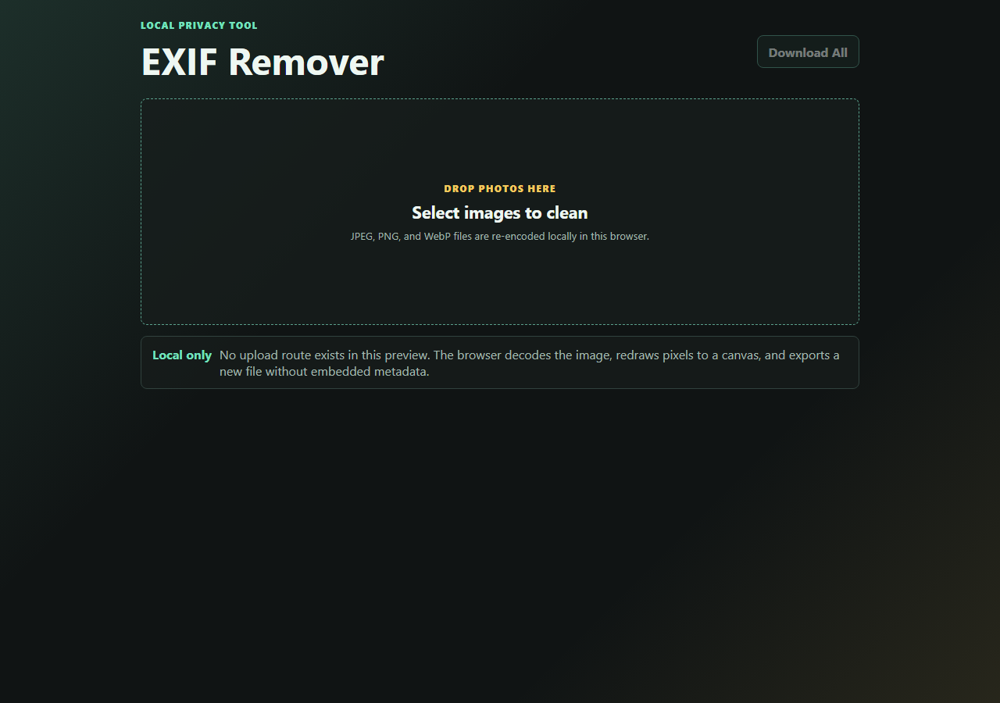

<p align="center"><a href="https://kitsunetechnologies.org/work"></a></p>

# EXIF Remover

Strip EXIF and metadata from images entirely in your browser. Nothing gets uploaded.

[](LICENSE)

**[Try it live](https://kitsunetech1.github.io/exif-remover/)**



## Features

- Accepts JPEG, PNG, and WebP images.
- Re-encodes every image through a browser canvas, which drops all embedded metadata.
- Exports cleaned copies with `-clean` added to the filename.
- Runs fully client-side. No upload route exists, nothing leaves the browser.

## Use it now

No install, nothing leaves your browser. Just open **[the live demo](https://kitsunetech1.github.io/exif-remover/)** and drop an image in. It works the same as running it locally, this is the same code.

## Run it yourself

You only need this if you want to run your own copy instead of using the live demo above.

### What you need

- **Node.js 18 or newer** (only needed to serve the files locally, it does no processing). Check with `node --version` in a terminal. If that gives an error instead of a version number, get Node from https://nodejs.org (the "LTS" button is the one you want).
- Any modern browser (Chrome, Firefox, Edge, Safari).

### Step by step

**Getting the files**

If you have git, clone it:

```powershell
git clone https://github.com/KitsuneTech1/exif-remover.git
cd exif-remover
```

If you don't have git, click the green **Code** button on this repo's GitHub page, then **Download ZIP**, then right-click the downloaded zip and choose **Extract All**.

**Opening a terminal in the right folder**

1. Open the extracted (or cloned) `exif-remover` folder in File Explorer.
2. Click the address bar at the top of the File Explorer window, type `powershell`, and press Enter. This opens a terminal already sitting in that folder.

**Starting the server**

3. In that terminal, type:

```powershell
node server.js
```

4. You should see a line printed like `EXIF remover preview: http://127.0.0.1:5173`.
5. Open your browser and go to `http://127.0.0.1:5173`.

**It worked if:** the page loads and shows the EXIF Remover drop area, and dropping an image in produces a cleaned download with `-clean` in the filename.

To stop the server, go back to the terminal window and press `Ctrl+C`.

**Troubleshooting**

- *`node` is not recognized:* Node.js isn't installed, or you need to close and reopen your terminal after installing it so it picks up the change.
- *"Not found" in the browser:* make sure the terminal's folder is the `exif-remover` folder itself (the one with `index.html` in it), not a folder above or below it.
- *Port already in use:* something else on your PC is using port 5173. Run `$env:PORT=5174; node server.js` instead, then open `http://127.0.0.1:5174`.

## How it works

The browser decodes the selected image into a canvas and redraws the pixels. The re-encoded output has no EXIF, GPS, or other metadata blocks because none of that data is part of the canvas pixel buffer.

## Limitations

Re-encoding means recompression. JPEG and WebP outputs are re-encoded at quality 0.92, so repeated cleaning cycles will lose some quality. Animated images are exported as still frames since the canvas only holds one decoded frame at a time.

## License

PolyForm Noncommercial 1.0.0 - free for personal and other noncommercial use. Commercial use requires a license from Kitsune Technologies. See [LICENSE](LICENSE).
