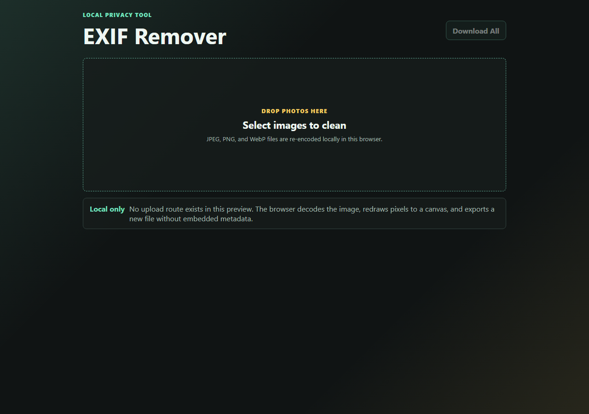

<p align="center"><a href="https://kitsunetechnologies.org/work"></a></p>

# EXIF Remover

Strip EXIF and location metadata from photos in your browser. Nothing is uploaded.

[](LICENSE)
[](https://tc39.es/ecma262/)

**[Try it live](https://kitsunetech1.github.io/exif-remover/)**



## What it does

- Lets you select or drop JPEG, PNG, and WebP images in the browser.
- Decodes each image and redraws it to a canvas, so EXIF, GPS, and other embedded metadata are not copied.
- Exports cleaned images with `-clean` added to the filename.
- Lets you download each cleaned image, plus all cleaned images from the current batch.
- Serves the same static app locally with a small Node.js server that has no upload route.

## What you need

To use the tool online, just open the [live demo](https://kitsunetech1.github.io/exif-remover/) and drop an image in. Nothing leaves your browser.

- Node.js 18 or newer. It only serves the files, it does no processing. Check your version with `node --version` in a terminal. If that prints an error instead of a version, get Node from https://nodejs.org (click the LTS button).
- Any modern browser (Chrome, Firefox, Edge, or Safari).

## Quick start

1. Clone the repo or download the ZIP:

   ```powershell
   git clone https://github.com/KitsuneTech1/exif-remover.git
   cd exif-remover
   ```

   No git? Click the green **Code** button on GitHub, choose **Download ZIP**, and extract it.

2. No dependencies to install. Just start the server:

   ```powershell
   node server.js
   ```

3. Open your browser to `http://localhost:5173`.

You should see the drop area. Select or drag an image in to clean it. Downloads have `-clean` added to the filename.

Stop the server with `Ctrl+C` in the terminal.

## Check it

Run the offline test suite from the project folder:

```powershell
npm test
```

The tests use Node's built-in test runner and the local preview server. They do not upload files or make network requests.

## Troubleshooting

- `node` is not recognized as the name of a cmdlet: Node.js is not installed, or you need to close and reopen your terminal after installing it so it finds the new command.
- `Not found` in the browser: make sure the terminal is in the `exif-remover` folder itself (the one with `index.html` in it), not a folder above or below it.
- `EADDRINUSE: address already in use localhost:5173`: something else is already using port 5173. Run `$env:PORT=5174; node server.js` instead, then open `http://localhost:5174`.
- `SyntaxError: Unexpected token` or similar on startup: your Node.js is older than version 18. Run `node --version` and upgrade from https://nodejs.org if it is below `v18`.

## How it works

The browser decodes the selected image into a canvas and redraws the pixels. The re-encoded output has no EXIF, GPS, or other metadata blocks, because none of that is part of the canvas pixel buffer.

Re-encoding means recompression. JPEG and WebP outputs are re-encoded at quality 0.92, so repeated cleaning cycles lose some quality. Animated images are exported as still frames, since the canvas holds one decoded frame at a time.

## License

MIT. Copyright (c) 2026 Kitsune Technologies LLC. Do what you like with it, commercially or otherwise, just keep the copyright notice. Full text in [LICENSE](LICENSE).

---

<p align="center"><sub>Part of <b>Buildtober 2026</b>: 31 open source projects in 31 days. Built by <a href="https://kitsunetechnologies.org/work">Kitsune Technologies</a>. More at <a href="https://github.com/KitsuneTech1">github.com/KitsuneTech1</a>.</sub></p>
